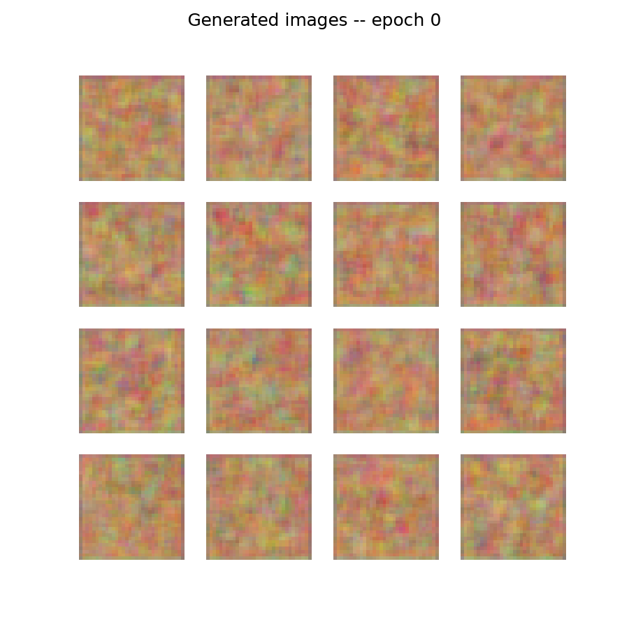
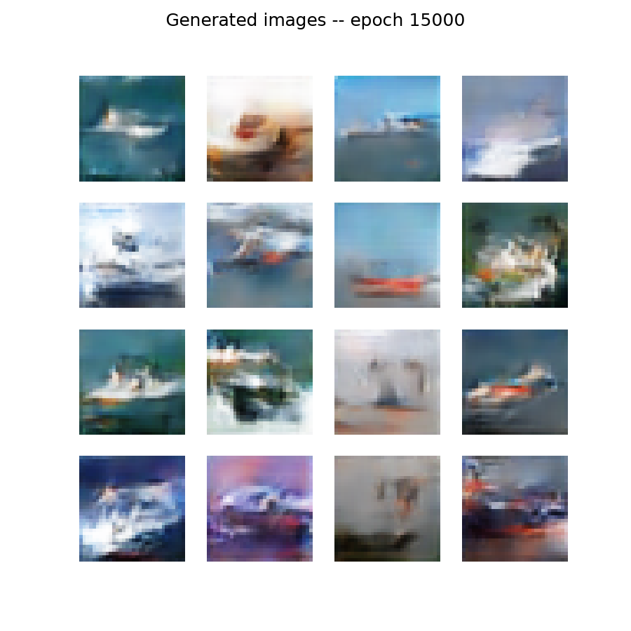

# DCGAN on CIFAR-10: Four Runs, Two Failure Modes, One Fleet of Ships

A DCGAN trained on the ship class of CIFAR-10 (5,000 images, 32x32), built as the
capstone for my M.S. in Artificial Intelligence and Machine Learning. The final
model works, but the reason this repo exists is the road to it: the same
architecture failed in two distinct, diagnosable ways before reaching a healthy
adversarial equilibrium, and the forensics are documented run by run below.

**The point of this repo is the debugging, not the ships.**

## Results first

| Run | Outcome | Evidence |
|---|---|---|
| 1 | Total mode collapse: 16 noise vectors, 1 identical image | [`runs/run1_frozen_judge/`](runs/run1_frozen_judge/) |
| 2 | Discriminator domination, collapse again | [`runs/run2_d_domination/`](runs/run2_d_domination/) |
| 3 | Same signature despite rebalancing (the key clue) | [`runs/run3_d_domination/`](runs/run3_d_domination/) |
| 4 | Equilibrium: losses orbit ln 2, sixteen distinct ships | [`runs/run4_equilibrium/`](runs/run4_equilibrium/) |

From noise to ships in run 4:

| Iteration 0 | Iteration 15,000 |
|---|---|
|  |  |

## Run 1: the frozen judge

Keras 3 optimizers capture their trainable variables at the first training step,
not at compile time the way Keras 2 did. The classic GAN recipe (set
`discriminator.trainable = False` after compiling D, before compiling the
combined model) therefore silently builds the discriminator's optimizer with an
empty variable list. The judge never learns. Verified directly: D's weights were
bit-identical after training steps, and Keras warned that the model had no
trainable weights.

Consequence: the generator spent 15,000 iterations optimizing against one fixed,
random network. That is not learning to paint ships; it is finding a single
adversarial pattern that exploits that specific frozen judge, which is why all
sixteen outputs are the same image. The loss curves are the other tell: perfectly
smooth curves in an adversarial system mean the adversary is missing. Healthy GAN
losses look like a seismograph.

Fix: toggle `discriminator.trainable` inside the loop, True before the
discriminator's update, False before the generator's update through the combined
model.

## Runs 2 and 3: the cheating judge

With D actually training, it won by too much: D loss pinned near 0.12 while G
loss climbed unbounded, and outputs collapsed again. Rebalancing (two generator
updates per iteration, BatchNorm-mode-consistent fakes) changed nothing between
runs 2 and 3, and that immunity was the real diagnostic: an advantage that
survives rebalancing is a shortcut, not a skill edge.

The shortcut was BatchNorm inside the discriminator. Training D on an all-real
batch and then an all-fake batch separately lets BatchNorm normalize each batch
by its own statistics, and real vs. fake batches have very different statistics.
D was classifying batch composition, not image content: an unbeatable tell that
no improvement to any individual forgery could overcome.

Fix: one mixed, shuffled batch of real and fake images per discriminator update,
so batch statistics carry no signal.

## Run 4: equilibrium

With the cheat removed, D held between 0.61 and 0.67 for the entire run and G
glided from 1.18 down to 0.84. The anchor for those numbers: at perfect
equilibrium the judge cannot tell real from fake, its best output is 0.5 for
everything, and the binary cross-entropy of 0.5 is ln 2 (about 0.693). GAN losses
are not driven to zero. Two networks hovering near 0.69 is a healthy stalemate; a
discriminator loss near zero means the generator is starved of gradient and
learning is dead.

Sixteen noise vectors now produce sixteen different ships, meaning the noise
input matters again, which is the definition of escaping mode collapse.

## Running it

```bash
pip install torch keras numpy matplotlib   # torch cu128 wheel for GPU
python gan_cifar10.py
```

Runs on the PyTorch backend of Keras 3 (`KERAS_BACKEND=torch`, set inside the
script). On an RTX 5090 a full 15,000-iteration run takes about ten minutes;
sample grids and loss curves are written to `screenshots/` as it trains.

## Lessons that transfer beyond GANs

1. Framework version changes can fail silently. Verify that weights actually
   move; do not assume the recipe still works.
2. When a metric is immune to your intervention, stop tuning and look for a
   shortcut the model found.
3. Loss curves carry texture information, not just values. Oscillation and
   stalemate are health in adversarial training; silence and runaway are disease.

## References

- Goodfellow et al. (2014), Generative Adversarial Nets, NeurIPS.
- Radford, Metz, and Chintala (2016), Unsupervised Representation Learning with
  Deep Convolutional GANs, ICLR.
- Salimans et al. (2016), Improved Techniques for Training GANs, NeurIPS.
